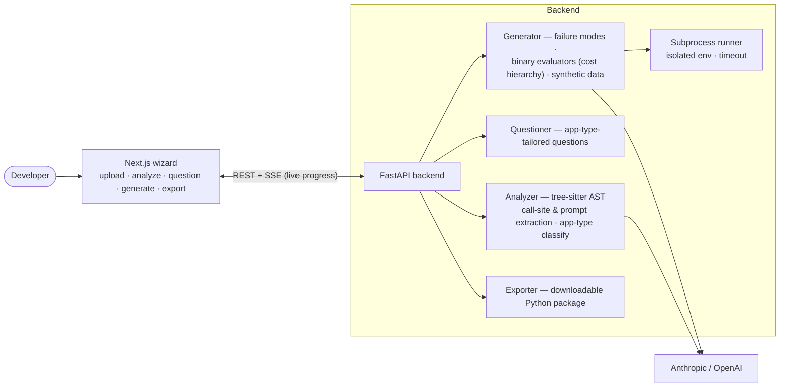

# EvalForge

**Point it at your LLM app, get a tailored evaluation suite.** EvalForge analyzes your code, finds where you call models and what you ask them, asks a few sharp questions about how your app can fail, and **generates evaluators + synthetic test data built for *your* failure modes** — not generic metrics. Export it as a ready-to-run Python package.


> **Why:** most teams either skip evals or bolt on generic metrics (BLEU, "helpfulness 1–5") that never catch the bugs that actually hurt. EvalForge starts from *your code and your failure concerns* and produces **binary, app-specific** evaluators — the approach argued for in Hamel Husain & Shreya Shankar's [*AI Evals FAQ*](#methodology--credits).

---

## How it works

A five-step wizard, with live progress streamed over SSE:

1. **Upload** — point at a local project folder; it previews the files (respecting `.gitignore`).
2. **Analyze** — tree-sitter AST parsing detects **LLM call sites** (OpenAI, Anthropic, LangChain, LiteLLM), extracts the **prompts**, and classifies the **app type** (RAG / agent / chatbot / doc-processing).
3. **Question** — 5–8 questions tailored to your app type and the gaps in the analysis (plus your own custom Q&A).
4. **Generate** — infers **failure modes**, then synthesizes **binary pass/fail evaluators** following a cost hierarchy (assertions → regex → LLM-as-judge only when judgment is genuinely subjective) and **dimensional synthetic test data**.
5. **Export** — toggle individual evaluators/cases on or off and download a pytest package with setup instructions. Implement one `run_app(input) -> str` hook in `app_adapter.py` to connect it to your app; `pytest eval_suite` then sends every test case through your app and checks each response.

## Architecture



Notable engineering: per-connection SSE queues for live progress, **subprocess-isolated evaluator execution** (`env={}`, hard timeout) so generated code can't read your secrets, and a cost-tiered evaluator strategy that reserves expensive LLM-judges for only the criteria that need them.

## Tech Stack

**Frontend** Next.js 15 · React 19 · TypeScript · Tailwind 4 · SSE
**Backend** FastAPI · Python 3.11 · tree-sitter (AST) · Anthropic + OpenAI SDKs · Pydantic
**Tooling** `uv` (Python), npm

## Getting Started

**Prerequisites:** Python 3.11+, [`uv`](https://docs.astral.sh/uv/), Node 18+, and Anthropic + OpenAI API keys.

```bash
git clone https://github.com/asharma353/evalforge.git
cd evalforge

# 1 · Backend  → http://localhost:8000
cd backend
cp .env.example .env          # add ANTHROPIC_API_KEY + OPENAI_API_KEY
uv sync
uv run uvicorn main:app --reload --port 8000

# 2 · Frontend (new terminal)  → http://localhost:3010
cd frontend
npm install
npm run dev
```

Open **http://localhost:3010** and point it at a local LLM project.

Backend tests: `cd backend && uv run pytest`.

## Status

- **v1.0 (shipped)** — the full upload → analyze → question → generate → export pipeline.
- **v1.1 (in progress)** — running the generated evals in-app + a binary-annotation table for building ground-truth (JSONL export).

## Methodology & credits

EvalForge operationalizes the error-analysis-first, binary-evaluator approach from **Hamel Husain & Shreya Shankar — *"Frequently Asked Questions (And Answers) About AI Evals"* (2025)**. See [REFERENCES.md](REFERENCES.md). That document is not redistributed here — grab it from the authors.

## License

[MIT](LICENSE) © 2025 Ayush Sharma

## Author

**Ayush Sharma** — Principal Data Scientist / ML & AI Engineer
🌐 [asharma353.github.io](https://asharma353.github.io/) · 💻 [github.com/asharma353](https://github.com/asharma353) · 💼 [linkedin.com/in/ayushsharma1](https://www.linkedin.com/in/ayushsharma1)
